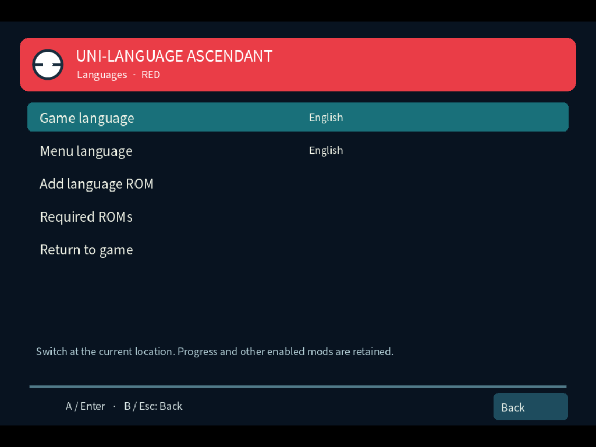
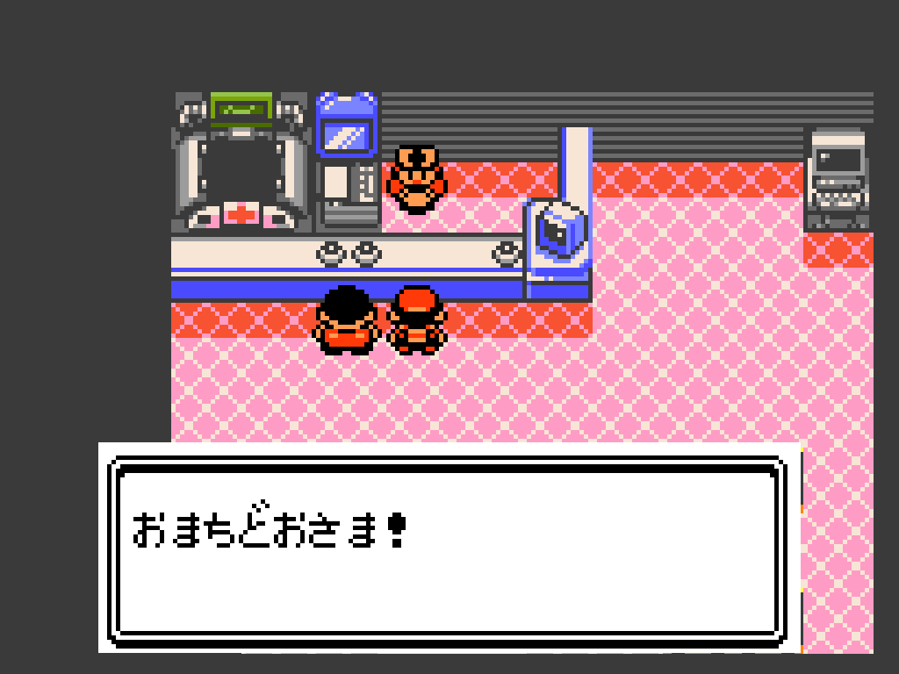
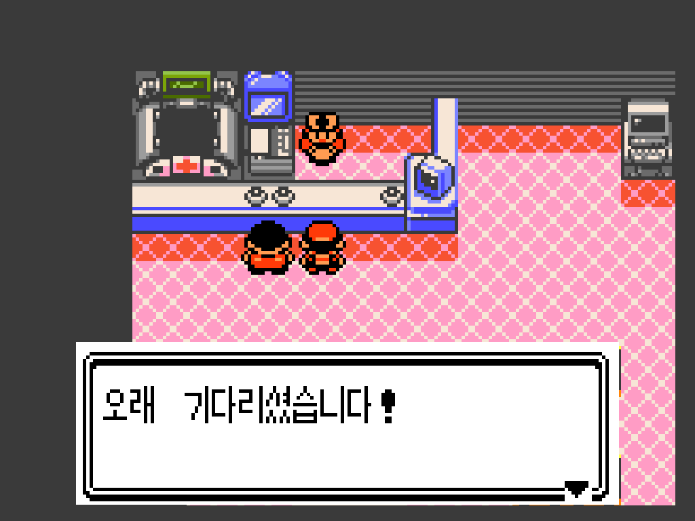
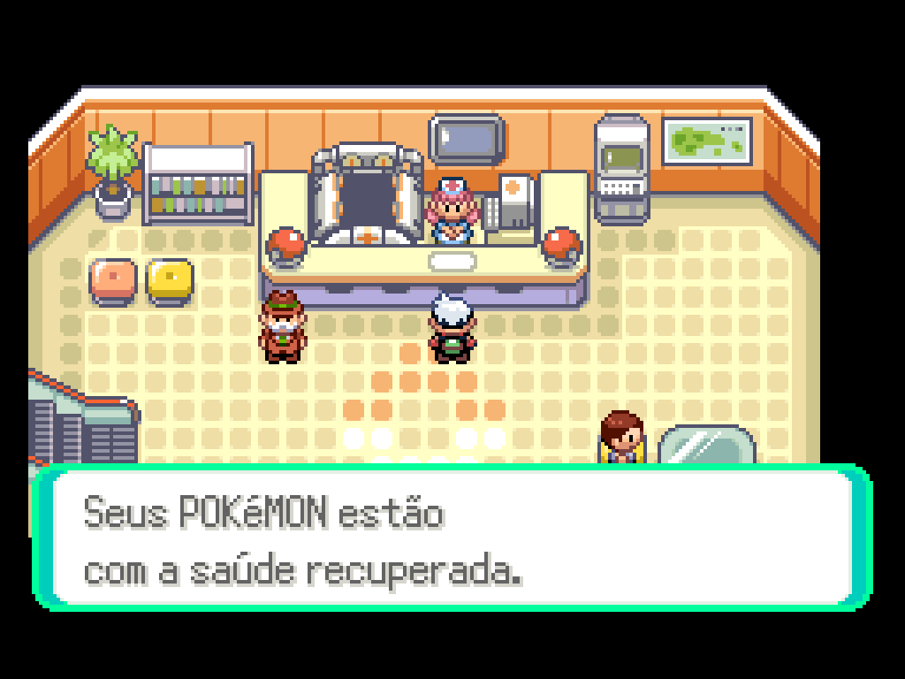

# Uni-Language Ascendant — Pokémon language mod for Gen1Recomp

**German, Brazilian Portuguese, supported European languages, Japanese Crystal and Korean Gold/Silver.** A standalone translation and localization mod for Gen1Recomp (the Pokémon Gen 1 recompiler), covering eleven Pokémon Gen 1–3 editions, with separate game/menu language choices and locally compiled language-ROM imports.

[Download the latest mod ZIP](https://github.com/Roxas2712/uni-language-ascendant/releases/latest) · [International guide & screenshots](https://roxas2712.github.io/uni-language-ascendant/) · [Exact ROM versions and SHA-1](https://roxas2712.github.io/uni-language-ascendant/roms.html)

## In-game language switching

Open **ASCENDANT → UNI-LANGUAGE** to choose the game language, change the menu language, add a matching language ROM or check the required ROM revision and SHA-1. Missing game profiles stay visible and disabled.

A game-language change keeps unsaved progress in memory and performs an in-process session handoff. After a loading pause, play resumes at the current location with the selected text, fonts and graphics. The application stays open. The first compilation can take longer than a cached switch. Large Ascendant combinations reload noticeably more slowly than the language mod alone.

Switch from settled offline overworld play. Finish dialogue, battle, movement and transitions first. The normal game save is not overwritten by a language switch. Failure recovery and progress checks are covered by the live-switch QA.

KASC can collect the Languages entry through its shared Ascendant menu protocol. Without KASC, the fallback hub combines language and VASC entries. Origami Gen3 receives a language entry in its Ascendant menu. Exact tested versions and combinations are documented; arbitrary mods are not universally certified.

## Supported Pokémon editions and languages

41 localized profiles across eleven editions, plus the English base:

| Edition | Game languages besides English |
| --- | --- |
| Red, Yellow | German, Brazilian Portuguese, Spanish |
| Blue, Ruby, Sapphire | German, Brazilian Portuguese |
| Gold | German, Brazilian Portuguese, Spanish, French, Italian, Korean |
| Silver | German, Brazilian Portuguese, Spanish, French, Korean |
| Crystal | German, Brazilian Portuguese, Spanish, Italian, Japanese |
| FireRed | German, Brazilian Portuguese, Spanish, Italian |
| LeafGreen | German, Brazilian Portuguese, Spanish, French |
| Emerald | German, Brazilian Portuguese, Spanish, French, Italian |

**Ten menu languages:** English, Deutsch, français, italiano, español, 日本語, 한국어, 简体中文, 繁體中文 and português brasileiro. Menu support does not imply a game-language profile exists. Chinese currently applies to the mod menu.

## Install and import

1. Import the exact supported English US base game in Gen1Recomp.
2. Download the ZIP from [GitHub Releases](https://github.com/Roxas2712/uni-language-ascendant/releases/latest), install it in the mod manager and enable Uni-Language Ascendant.
3. Import the exact language ROM through the launcher’s mod Imports panel or the desktop file picker in the in-game language menu. On other platforms, use the launcher’s Imports panel. Check the [ROM checklist](https://roxas2712.github.io/uni-language-ascendant/roms.html); file names alone do not identify a revision.
4. Choose the menu language, then an available game language. The Ascendant intro runs once per mod profile.

Sapphire PT-BR uses the exact Ruby PT-BR source import with separate Sapphire recipes and authored compatibility text. FRLG PT-BR fanpatch sources use revision 1.1; the runtime uses its supported US 1.0 base. Follow the [source and patch identities](tools/ptbr_sources.json).

Updates preserve imported ROMs, preferences, intro state and saves. **Uninstalling deletes the mod profile; reinstalling starts fresh.** The cache rebuilds when needed. The ZIP contains mod code and recipes; users provide the ROM inputs. Keep Asian source ROMs imported so saved Japanese/Korean names remain readable after switching to English.

## Real gameplay screenshots

| Japanese Crystal | Korean Gold |
| --- | --- |
|  |  |

These images come from actual game scripts and the running menu. Some use prepared test saves. Tests do not inject invented dialogue as translation evidence. The menu and German Red captures come from the live-switch tests. Japanese and Korean captures use the Asian-profile QA workflow; Emerald PT-BR uses the translation regression workflow.

## International introductions

[Deutsch](docs/i18n/README.de.md) · [Português brasileiro](docs/i18n/README.pt-BR.md) · [Español](docs/i18n/README.es.md) · [Français](docs/i18n/README.fr.md) · [Italiano](docs/i18n/README.it.md) · [日本語](docs/i18n/README.ja.md) · [한국어](docs/i18n/README.ko.md) · [简体中文](docs/i18n/README.zh-Hans.md) · [繁體中文](docs/i18n/README.zh-Hant.md)

The edition matrix above applies to every language introduction.

## Verification and provenance

Release 1.8.0 separates the [translation regression baseline](docs/Regression-Baseline-1.8.json) from [final live-switch QA](mod/LIVE-SWITCH-QA.json). The baseline has 113 process runs; the final session code is checked through 21 additional isolated processes covering all 41 localized profiles, real healing interactions, rollback/recovery and the listed mod combinations, plus six fresh-process interruption/recovery checks and a complete first-profile intro/picker/gameplay check. [Release QA](mod/MERGE-QA.json) records the source difference and fresh unit checks (85 Python tests, 19 Lua groups), so the baseline is not presented as 113 reruns of the final cleanup.

[Asian profile scope](mod/ASIAN-PREVIEW.md) distinguishes native ROM mappings from authored US-compatibility translations. All 508 previously unfilled Crystal slots are covered: 356 additional native mappings and 152 authored compatibility translations. Regional mechanics remain those of the US base.

[ZIP install/update/uninstall/reinstall check](docs/Install-1.8.json) records the tested archive checksum.

Historical evidence: [European QA](mod/EUROPE-QA.json), [PT-BR gameplay report](mod/PT-BR.html), [optimization measurements](docs/Optimization-1.5.1.json). These are scoped checks rather than full-story playthroughs or native-speaker certification. Windows/Linux and two-device multiplayer are not certified by the local macOS QA.

## Project and license

Built for the [Pokémon Gen 1 Recompilation Project](https://github.com/bryanthaboi/gen1recomp) by BOIS CLUB GAMES, LLC. GPLv3 and existing attribution remain in force: [LICENSE.MD](LICENSE.MD), [license policy](LICENSE-POLICY.md), [vendor notices](mod/VENDOR.md). Bundled fonts and Ascendant intro assets retain their included notices.
